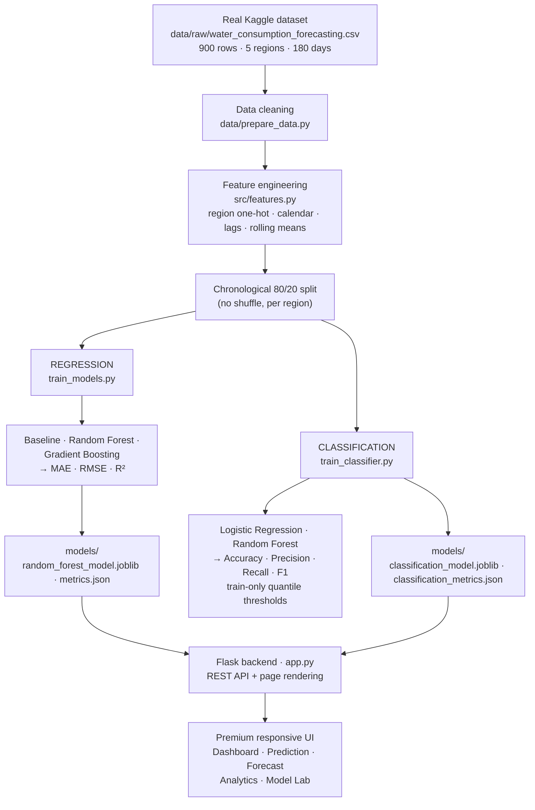

# SmartWater AI
  LIVE WEB: https://smartwater-ai-d88c.onrender.com
  
A production-style AI/ML application that forecasts **daily water consumption**
and classifies it into **demand levels**, built on a real Kaggle dataset of
daily municipal water consumption across five regions.

The system performs two ML tasks on the same leakage-safe feature pipeline:

| Task | What it predicts | Output |
|---|---|---|
| **Regression** | continuous daily consumption | `Predicted Water Consumption: 12,450 L/day` |
| **Classification** | demand category | `LOW` / `NORMAL` / `HIGH` / `VERY HIGH` |

The application ships as a premium Flask web app with a dashboard, prediction
interface, 7-day forecast, analytics, and an AI model lab.

---

## Problem Statement

Water utilities must anticipate daily demand to plan supply, pumping
schedules, maintenance windows, and avoid over- or under-production. A model
that forecasts tomorrow's consumption — and flags whether demand will be
unusually low or high — lets operators respond before problems occur.

This project:
1. Builds and honestly evaluates **regression models** (Baseline, Random
   Forest, Gradient Boosting) that predict daily consumption in liters.
2. Builds and honestly evaluates **classification models** (Logistic
   Regression, Random Forest) that predict the demand level derived from
   training-set consumption quantiles.
3. Packages both into a polished, responsive web application.

---

## Dataset (Real Kaggle Data)

**Source:** `data/raw/water_consumption_forecasting.csv`

| Property | Value |
|---|---|
| Rows | 900 |
| Columns | `region`, `date`, `consumption_liters` |
| Regions | Central, East, North, South, West (5) |
| Days per region | 180 |

The dataset contains **only** region, date, and consumption. There is **no**
temperature, humidity, or holiday column, and this project does **not**
invent those variables — features are limited to calendar signals and the
region's own consumption history.

## Data Preprocessing (`data/prepare_data.py`)

The real dataset is validated and cleaned:

- Parse dates (drop unparsable rows)
- Drop rows with missing region / date / consumption
- Remove exact duplicate rows and duplicate `(region, date)` keys
- Keep only positive consumption values
- Standardize column order and types

Cleaning report on the real file: **0 issues found** (the Kaggle file is
already clean) → 900 rows written to `data/processed/water_demand_clean.csv`.

> The old synthetic weather-driven generator is preserved **only as a backup**
> (`python data/prepare_data.py --synthetic` writes
> `data/processed/water_demand_synthetic_clean.csv`). The application never
> uses it.

## Feature Engineering (`src/features.py`)

`build_features()` is used identically at train time and inference time.
Final feature set (12 columns):

| Feature | Description |
|---|---|
| `region_Central/East/North/South/West` | one-hot encoding of region |
| `month` | calendar month (1–12) |
| `day_of_week` | weekday (0 = Monday … 6 = Sunday) |
| `is_weekend` | 1 if Saturday/Sunday, else 0 |
| `lag_1` | consumption 1 day earlier (same region) |
| `lag_7` | consumption 7 days earlier (same region) |
| `rolling_mean_7` | mean of the previous 7 days (same region) |
| `rolling_mean_14` | mean of the previous 14 days (same region) |

**Leakage safety:**
- Lag/rolling features are computed **per region** (`groupby`), so no row
  ever sees another region's values.
- `shift(1)` is applied **before** any rolling window, so a row never uses
  its own or a future day's target.
- The 14-day warm-up window per region (rows 1–14) is dropped before
  training.

## Train/Test Methodology

A strict **chronological 80/20 split** is used — **no random shuffle** —
because this is a time-series problem. The split is performed per region so
every region's test set is its own most recent 20% of days (true
out-of-sample forecasting). The regression and classification tasks use the
**same split**:

Why chronological: shuffling would let the model "peek" at the future during
training. Deployed forecasts only ever predict days after the training data,
so evaluation must respect time order.

---

## Regression (`train_models.py`)

Predicts continuous `consumption_liters`. Models compared:

1. **Baseline** — naive previous-day-value forecast (`lag_1`)
2. **Random Forest Regressor** (`n_estimators=300, max_depth=10, min_samples_leaf=2`)
3. **Gradient Boosting Regressor** (`n_estimators=300, max_depth=3, learning_rate=0.05`)

### Regression Metrics (chronological test set, L/day)

| Model | MAE | RMSE | R² |
|---|---|---|---|
| Baseline (naive lag_1) | 4,573.29 | 5,595.92 | −0.8572 |
| **Random Forest** ✅ | **3,564.73** | **4,149.29** | **−0.0211** |
| Gradient Boosting | 3,705.09 | 4,317.58 | −0.1056 |

**Best regression model: Random Forest** (highest R²), saved as
`models/random_forest_model.joblib` and used by the app.

**What R² means here (viva-safe explanation):** R² is the proportion of
variance in the test set explained by the model relative to predicting the
mean. R² ≈ 0 means the model performs about as well as predicting the
historical average — and this is a *property of the data*, not a bug. The
real dataset has **near-zero day-to-day autocorrelation** (lag-1 correlation
≈ 0.01–0.04 per region): consecutive days are essentially independent, so no
model can extract temporal signal from lag features alone. We report the
truthful numbers rather than inflated ones. A useful model would need
additional exogenous features (weather, holidays, events) that this dataset
does not contain.

## Classification (`train_classifier.py`)

Predicts `demand_level` ∈ {LOW, NORMAL, HIGH, VERY HIGH}.

### Thresholds (derived from the TRAINING SET only — no test leakage)

Classes are created from **training-set consumption quartiles**:

| Threshold | Value (L/day) | Class |
|---|---|---|
| — | < 9,382.28 | LOW |
| q25 | 9,382.28 – 13,140.42 | NORMAL |
| q50 | 13,140.42 – 16,431.28 | HIGH |
| q75 | ≥ 16,431.28 | VERY HIGH |

The same train-fitted thresholds are applied to test data and future
predictions, so the test set never influences the labels.

### Classification Metrics (same chronological test set)

| Model | Accuracy | Precision (macro) | Recall (macro) | F1 (macro) | F1 (weighted) |
|---|---|---|---|---|---|
| Logistic Regression | 0.2882 | 0.1437 | 0.2801 | 0.1849 | 0.1853 |
| **Random Forest** ✅ | 0.2235 | 0.2237 | 0.2240 | **0.2100** | **0.2122** |

**Best classifier: Random Forest** (selected by weighted F1; it also
outperforms LR on macro F1). Its confusion matrix on the test set
(rows = actual, columns = predicted, order LOW/NORMAL/HIGH/VERY HIGH):

```
[[17,  8,  5, 17],
 [16,  4,  1, 21],
 [17,  9,  6, 13],
 [10,  6,  9, 11]]
```

Honest note: with 4 balanced classes, random guessing scores ~25% accuracy.
Both classifiers are near chance (22–29%) because the features carry little
signal — consistent with the regression finding. Random Forest is preferred
because it discriminates across all four classes, whereas Logistic
Regression collapses to only two.

---

## Is R² ≈ 0 a bug? — the Information Ceiling

No. It is the measured limit of this dataset, and the project proves it rather
than asserting it. Run `python analysis/signal_audit.py` (also served at
`GET /api/signal-audit` and shown in the Model Lab):

| Test | Result |
|---|---|
| Ljung-Box white-noise test, lags 7/14/21 × 5 regions | **1 of 15 tests rejects** white noise at α=0.05 (0.75 expected by chance) |
| Lag-1 autocorrelation, worst case across regions | \|r\| ≤ 0.057 — yesterday carries no usable information about today |
| Variance explained by region alone | **0.48%** |
| **Information ceiling** (best constant predictor = train mean) | **MAE 3,514.3 · R² −0.0075** |
| Deployed Random Forest | MAE 3,564.7 · R² −0.0211 |
| **Gap to the ceiling** | **1.4%** |
| Classifier ceiling (always predict the majority class) | accuracy 0.2706 |
| Deployed Random Forest classifier | accuracy 0.2235 |

The series are statistically indistinguishable from white noise, so the best
any model can do is predict the mean. The deployed regressor sits **1.4% away
from that ceiling** — it is essentially optimal for this data, and its R² ≈ 0
is a property of the dataset, not a modelling defect.

The classifier sits *below* its ceiling, which is the expected signature of a
model fitting noise: with no signal, an unregularised forest can only do worse
than the majority-class rule. This is reported rather than hidden.

## System Architecture



## Application Features

| Page | Contents |
|---|---|
| **Dashboard** (`/`) | Hero, KPI cards (average / peak / minimum / latest consumption), consumption trend, regional comparison, monthly pattern, AI insights computed from real values |
| **Prediction** (`/prediction`) | Region + date form → predicted consumption (L/day), demand-level badge, "Why this prediction?" built from the actual features used |
| **Forecast** (`/forecast`) | 7-day recursive forecast per region: date, predicted consumption, demand level, day type + chart + methodology |
| **Analytics** (`/analytics`) | Consumption over time, regional comparison, monthly pattern, weekday vs weekend, regional min–max range, distribution, insights |
| **Model Lab** (`/model-performance`) | Regression metrics (MAE/RMSE/R²), classification metrics (accuracy/precision/recall/F1 macro + weighted), confusion-matrix heatmap, feature importance, thresholds, training info |

Design: luxury editorial water-intelligence identity. Palette — Cloud ivory
`#FFF8E7`, Deep Ocean Navy `#12284B`, Blueberry `#0055A0`, Bluebird `#438BC4`,
Clear Sky `#8CC1E9`. Typography — Fraunces for display headings, Inter for UI
and body, IBM Plex Mono for metrics, timestamps and technical data. Hairline
borders, restrained shadows, generous whitespace. The hero is the real
photograph `static/assets/Smartwaterslide1.png` in a container sized and
masked to accept a looping video later without layout change. Responsive from
320px to 1440px+, no page-level horizontal scrolling.

## API Endpoints

| Endpoint | Method | Description |
|---|---|---|
| `/api/health` | GET | Health check, best model, classifier status |
| `/api/metrics` | GET | Regression evaluation metrics |
| `/api/classification-metrics` | GET | Classification evaluation metrics + thresholds |
| `/api/confusion-matrix` | GET | Confusion matrix + per-class metrics (best classifier) |
| `/api/predict` | POST | `{region, date}` → predicted consumption + demand level + features |
| `/api/dashboard-stats` | GET | KPI statistics |
| `/api/analytics-data` | GET | Data for analytics charts |
| `/api/feature-importance` | GET | Feature importance of the best regression model |
| `/api/forecast` | GET | `?region=` → 7-day forecast with demand levels |

Example prediction:

```bash
curl -X POST http://127.0.0.1:5000/api/predict \
  -H "Content-Type: application/json" \
  -d '{"region": "North", "date": "2023-07-01"}'
```

```json
{
  "date": "2023-07-01",
  "region": "North",
  "predicted_consumption": 13372.404,
  "demand_level": "VERY HIGH",
  "unit": "L/day",
  "model_used": "RandomForest",
  "classifier_used": "RandomForestClassifier",
  "features": {
    "is_weekend": 1,
    "lag_1": 11305.24,
    "lag_7": 11804.79,
    "rolling_mean_7": 14419.15,
    "rolling_mean_14": 13161.73
  }
}
```

## Forecast Methodology

The 7-day forecast is a **recursive multi-step forecast**: each region's lag
buffer is seeded with its last 30 days of actual consumption; day 1 is
predicted from those actuals, the prediction is fed back into the buffer,
and day 2 uses day 1's prediction as `lag_1`, and so on. Each day also gets
a demand level from the classifier built on the same feature state. This is
the standard approach when true future values are unknown.

The buffer holds **actual readings only**. Predicted days feed forward inside a
single `forecast()` call and the region's real history is restored afterwards, so a
later `/api/predict` call is never influenced by earlier forecasts and returns the
same answer regardless of what the server was asked before.

## Saved Artifacts (`models/`)

- `random_forest_model.joblib` — best regression model
- `gradient_boosting_model.joblib` — second regression model
- `classification_model.joblib` — best classifier (Random Forest)
- `feature_list.joblib` / `classification_feature_list.joblib` — feature columns
- `metrics.json` — regression metrics + split metadata
- `classification_metrics.json` — classification metrics + thresholds
- `classification_thresholds.json` — training-set quantile thresholds
- `recent_history.csv` — per-region recent consumption for inference features

## Installation

```bash
cd smartwater-ai
python3 -m venv venv
source venv/bin/activate        # Windows: venv\Scripts\activate
pip install -r requirements.txt
```

## Running the Application

```bash
# 1. Prepare the real dataset (cleans data/raw/water_consumption_forecasting.csv)
python data/prepare_data.py

# 2. Train models (only needed once, or to refresh artifacts):
python train_models.py          # regression
python train_classifier.py      # classification

# 3. Start the Flask app
python app.py
```

Then open **http://127.0.0.1:5000/**.

> Pre-trained artifacts are already saved in `models/`, so the app runs
> immediately with `python app.py`.

## Project Structure

```
smartwater-ai/
├── app.py                    # Flask backend + REST API
├── wsgi.py                   # production WSGI entrypoint (gunicorn)
├── train_models.py           # regression training + evaluation
├── train_classifier.py       # classification training + evaluation
├── analysis/signal_audit.py  # white-noise tests + information ceiling
├── tests/                    # pytest suite (54 tests)
├── requirements.txt          # pinned runtime deps
├── requirements-dev.txt      # test deps
├── LICENSE                   # MIT
├── data/
│   ├── prepare_data.py       # real-data cleaning (synthetic = backup only)
│   ├── raw/water_consumption_forecasting.csv   # REAL Kaggle dataset
│   └── processed/water_demand_clean.csv        # cleaned dataset
├── src/
│   ├── features.py           # leakage-safe feature engineering pipeline
│   └── predict.py            # inference: predict, classify, forecast
├── models/                   # trained models, metrics, thresholds, history
├── static/
│   ├── style.css             # premium design system
│   └── app.js                # shared UI helpers
└── templates/                # dashboard, prediction, forecast, analytics, model lab
```

## Testing

The suite is **non-mutating**: it reads the dataset and saved artifacts and can
never change the reported metrics.

```bash
pip install -r requirements.txt -r requirements-dev.txt
python -m pytest tests/ -q          # 54 passed
```

It locks down the contracts the results depend on: dataset shape, the 14-day
warm-up drop, the per-region lag construction, the past-only rolling window,
the chronological split boundaries, reproduction of every stored metric from
the saved model, the train-only quantile thresholds, every API endpoint and
error path, the prediction-payload feature values, forecast determinism, and
the JavaScript syntax of every page's inline script.

## Running in production

The development server is single-threaded and for local demos only:

```bash
gunicorn --workers 4 --bind 0.0.0.0:8000 wsgi:app
```

## Limitations

- **Weak temporal signal:** the real dataset has near-zero day-to-day
  autocorrelation, so regression R² ≈ 0 and classification ≈ chance. This is
  a property of the data (no weather/holiday/exogenous features exist in it).
- **Short horizon:** 180 days per region (one spring–summer window); no
  multi-year seasonality can be modeled.
- **Recursive forecast error** accumulates over the 7-day horizon.
- **Development server:** Flask's built-in server is for local use, not
  production deployment.

## Future Improvements

- Add exogenous features (weather, holidays, events) if a richer dataset
  becomes available.
- Multi-year data for seasonal modeling; live ingestion of daily readings so
  lags use true actuals.
- Hyperparameter tuning with time-series-aware cross-validation (e.g.,
  expanding-window backtesting).
- Production deployment (gunicorn + containerization), authentication, and a
  database-backed history of forecasts vs actuals.
